# Laboratory Work №4 — Cloud Storage: Amazon S3

| Field | Value |
|---|---|
| Student | **Yakovlev Vladyslav** |
| Group | **IA2404** |
| Specialty | **Applied Informatics (Informatică aplicată)** |
| Level | **Advanced — tasks 1–14** |
| Date | 04.11.2026 |
| AWS region | `eu-central-1` (Frankfurt) |
| Repository | [TimeCapsule](https://github.com/my-php-deploying-labs-organization/timecapsule) |
| Code changes | [Commit 9814475](https://github.com/my-php-deploying-labs-organization/timecapsule/commit/98144757197c00e1794cb3ef1d18fd5843ccf5b0) |

## Objective and architecture

The objective was to migrate capsule attachments from the application EC2 instance's local filesystem into private Amazon S3, configure versioning and lifecycle management, restrict access with IAM, and enable direct downloads via temporary presigned URLs.

**Bucket:** `timecapsule-dev-uploads-yakovlev` · **Prefix:** `uploads/` · **App:** PHP OOP / Nginx / PHP-FPM on EC2 · **DB:** PostgreSQL on a separate EC2 instance. The existing Lab 3 VPC, bastion, subnets and routes were retained.

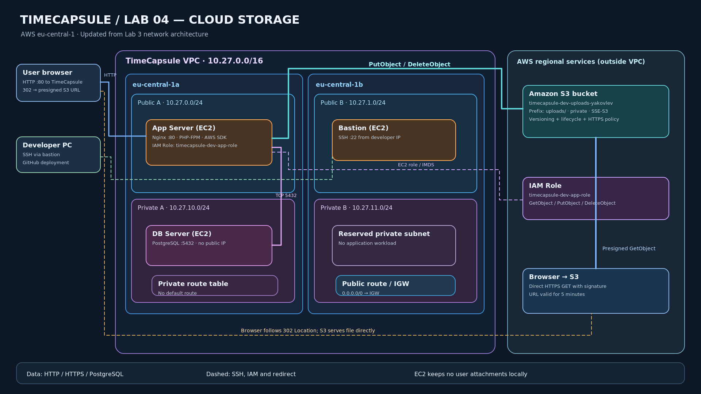

Editable version: [architecture.drawio](architecture.drawio). Architectural rationale: [ADR-0003](0003-attachment-storage.md).

## Part 1 — S3 fundamentals

### Task 1. Bucket and objects

Created the general-purpose bucket with disabled ACLs, all public access blocked, SSE-S3 encryption, and initial versioning disabled; used the `Lab=lab4` tag alongside project tags. Created the `uploads/` and `backups/` prefixes and uploaded sample objects. The picture's key is `uploads/img1.jpg`; its metadata includes `ETag`, `Content-Type`, and the object URL. Direct anonymous access to Object URL is not authorized because the object is private. In S3, folders represent key prefixes (and sometimes zero-byte folder-marker objects), not filesystem directories.

| Bucket prefixes | Picture object metadata |
|---|---|
| 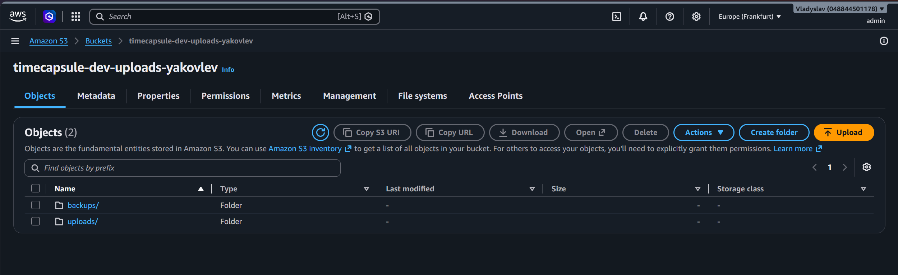 | 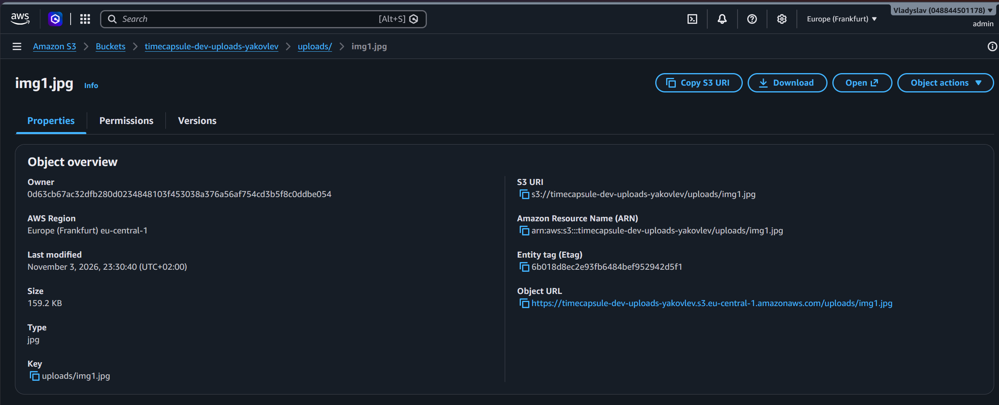 |

### Task 2. AWS CLI operations

Used CloudShell to upload objects via `aws s3 cp` and `aws s3 sync`, inspect the bucket with three variants of `aws s3 ls`, read metadata with `s3api head-object`, download `uploads/photo.txt`, and remove `uploads/2026/10/report-2.txt`. Standard listing shows grouped `PRE` entries; `--recursive` shows complete object keys. The `report.txt` object was inspected using `head-object` rather than downloaded; its content type is set during upload based on MIME inference.

| Listing | Metadata | Download / removal |
|---|---|---|
| 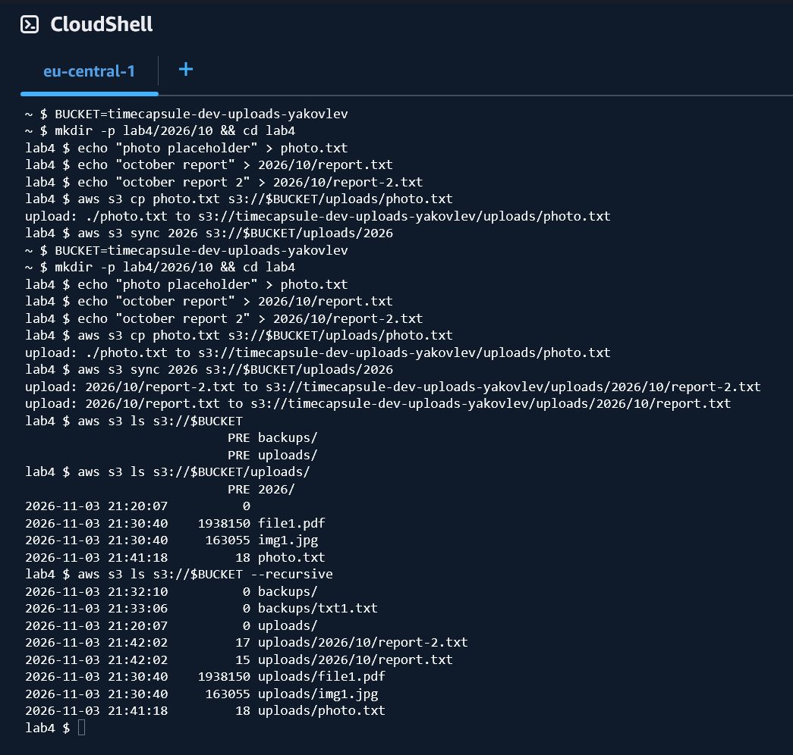 | 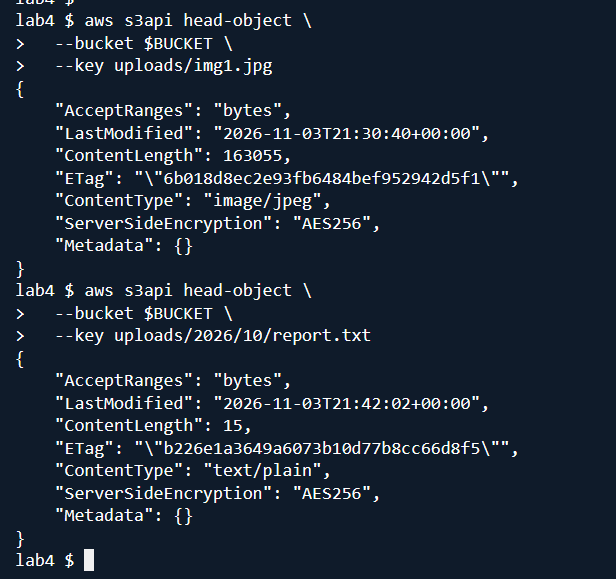 | 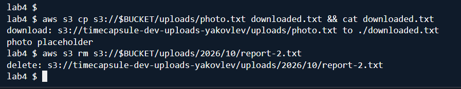 |

### Task 3. HTTPS-only bucket policy

Created a bucket policy with `Effect: Deny`, `Principal: "*"`, `Action: "s3:*"`, both bucket and object ARNs, and the condition `aws:SecureTransport = false`. Normal HTTPS requests succeeded, whereas the explicit HTTP endpoint request was denied. An explicit deny overrides an IAM administrator's allow. Block Public Access does not block a policy that **denies** insecure requests to everyone.

| Bucket policy | HTTPS / HTTP test |
|---|---|
| 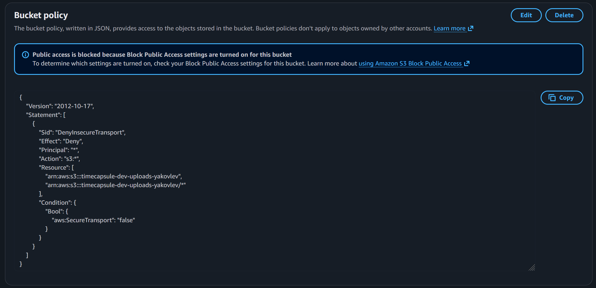 | 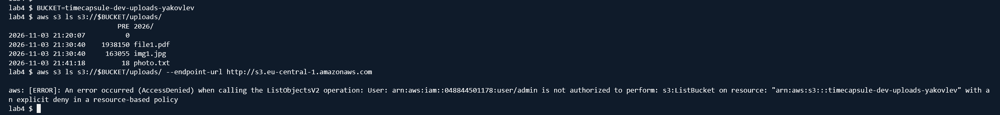 |

### Task 4. Versioning and deletion recovery

Enabled bucket versioning and uploaded `notes.txt` first with `v1`, then `v2`. Deleting the key without displaying versions created a **delete marker**; deleting the marker restored access to `v2`. Permanently deleting the identified `v2` version exposed the retained `v1` version. Objects created before versioning can have `VersionId = null`. Ordinary deletion is reversible through the marker; deleting a specific version is permanent and must not be permitted to the application.

| Delete marker | Restored/rolled-back version |
|---|---|
| 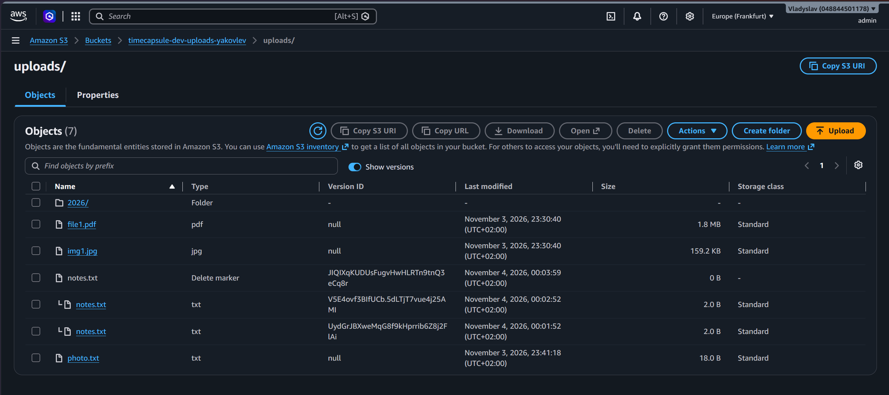 | 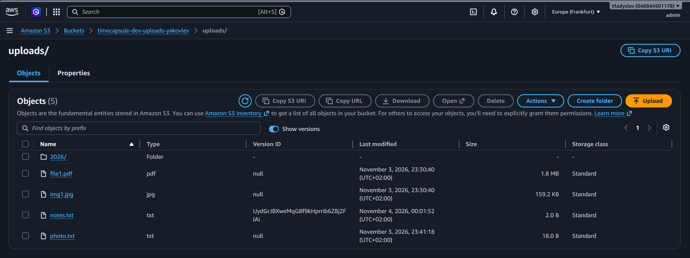 |

### Task 5. Lifecycle rule

Configured `timecapsule-dev-noncurrent` scoped to `uploads/`: transition eligible noncurrent versions to Standard-IA after 30 days; expire noncurrent versions after 90 days, retaining two newer noncurrent versions; abort incomplete multipart uploads after seven days. For an object rewritten ten times, older noncurrent versions become eligible for transitions and expiration as each individual version ages; the latest two noncurrent versions are protected from expiration. Small objects may not transition to Standard-IA under S3's default 128 KiB minimum size. Incomplete multipart parts incur storage charges until completed or aborted.

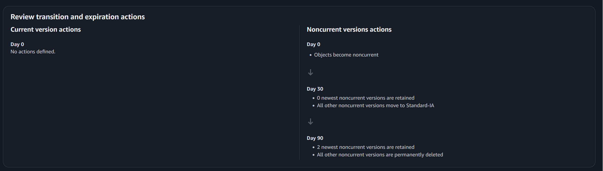

### Task 6. Presigned URLs

Generated a five-minute URL in the console and a two-minute URL with `aws s3 presign`. The original URL allowed a private object to be opened without logging into AWS. Editing the signed key from `photo.txt` to `notes.txt` invalidated the request signature; the unmodified URL expired according to its `X-Amz-Expires` value. The CLI constructs the signed URL locally; S3 validates it when the browser requests the object.

| URL creation | Private browser | Modified-key error |
|---|---|---|
| 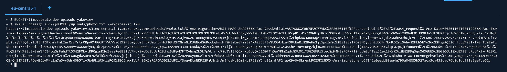 | 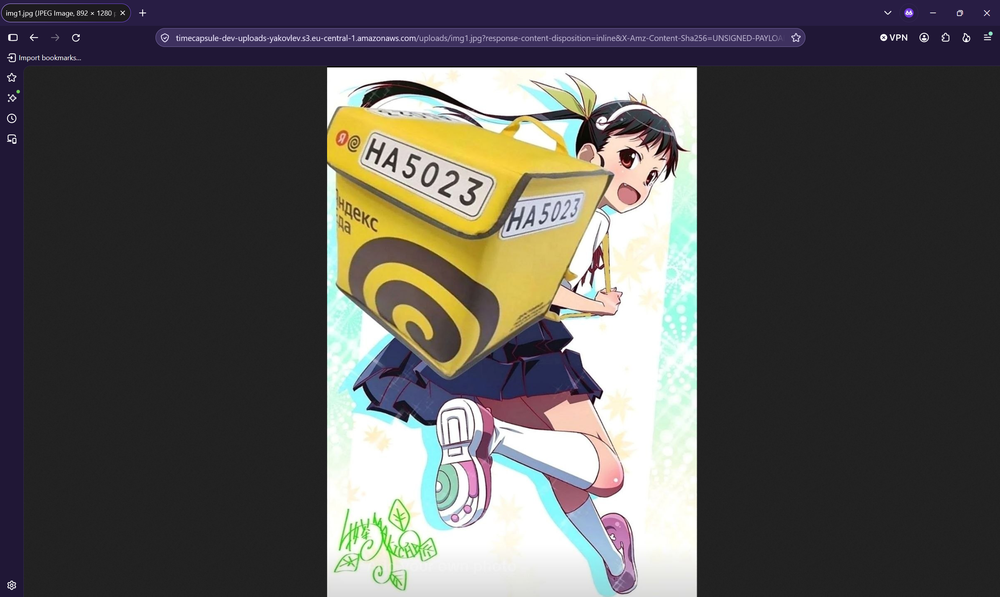 | 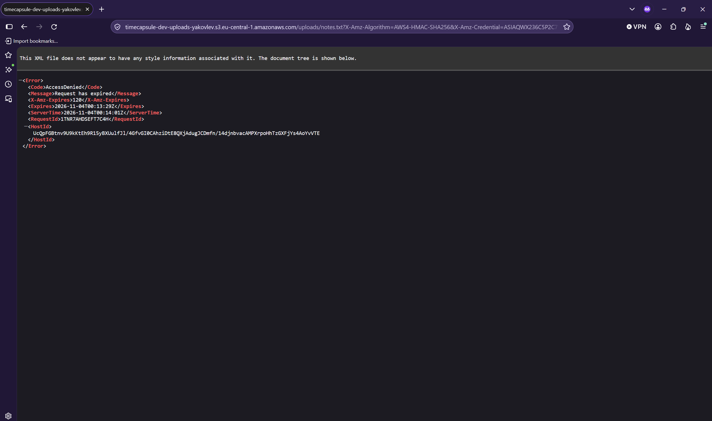 |

## Part 2 — Application integration

### Task 7. Application IAM policy

Created `timecapsule-dev-app-s3` with `s3:ListBucket` constrained by `s3:prefix = uploads/*` on the bucket ARN; granted `s3:GetObject`, `s3:PutObject` and `s3:DeleteObject` only for `arn:aws:s3:::timecapsule-dev-uploads-yakovlev/uploads/*`. Bucket listing and object operations have different ARN resource types. Granting the wrong ARN would cause the relevant request to be denied.

| Policy definition | Policy details |
|---|---|
|  |  |

### Task 8. Tester role and permission evaluation

Created the role `timecapsule-dev-s3-tester` trusted by the account and assumed it in CloudShell with STS. Verified the assumed-role ARN, then tested the following requests. **Allow** comes from the app policy; **implicit deny** means no matching allow; **explicit deny** is from the bucket's HTTPS policy.

| № | Operation | Expected / observed | Rule |
|---|---|---|---|
| 1 | Upload `uploads/test.txt` | Allow | `PutObject` |
| 2 | List `uploads/` | Allow | Scoped `ListBucket` |
| 3 | List bucket root | AccessDenied | Implicit deny |
| 4 | Download `uploads/photo.txt` | Allow | `GetObject` |
| 5 | List `backups/` | AccessDenied | Implicit deny |
| 6 | Upload `backups/test.txt` | AccessDenied | Implicit deny |
| 7 | `list-object-versions` | AccessDenied | Implicit deny |
| 8 | Delete an object by VersionId | AccessDenied | Implicit deny (`DeleteObjectVersion`) |
| 9 | Ordinary delete of `uploads/test.txt` | Allow; creates delete marker | `DeleteObject` |
| 10 | List `uploads/` using HTTP | AccessDenied | Explicit bucket-policy deny |

The trust policy defines **who may assume a role**, while the permissions policy defines **what the role may do**. The application may create a delete marker, but cannot erase version history via `DeleteObjectVersion`. The original IAM identity was restored by unsetting the temporary credential environment variables.

| Assumed identity | Test commands 1 | Test commands 2 |
|---|---|---|
|  | 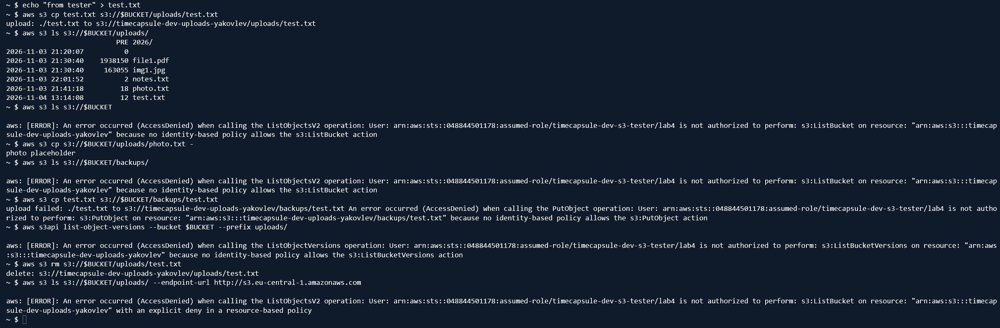 | 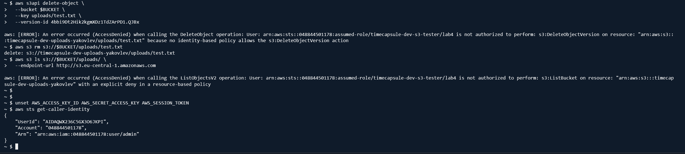 |

### Task 9. EC2 instance role

Created `timecapsule-dev-app-role`, trusted by EC2, attached the application policy, and associated the role with `timecapsule-dev-app`. AWS CLI on the instance obtained temporary credentials from EC2 instance metadata without `aws configure`. The instance could list `uploads/` but not `backups/` while `ListBucket` was still attached. Unlike permanent keys in `.env`, instance role credentials are rotated automatically.

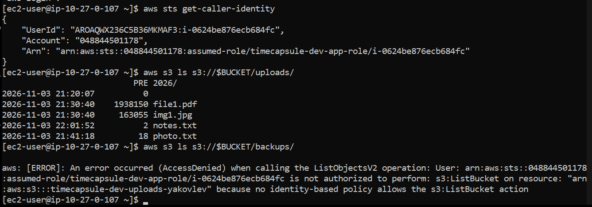

### Task 10. Migration of existing attachments

The real deployment directory was `/var/www/timecapsule` (not the instructional `current` symlink). Local `storage/uploads/` contained the original image `26691e7bed56ff0704dd6f55f45f10a3.png`. Used `aws s3 sync storage/uploads s3://$BUCKET/uploads/` and verified the result with a second `--dryrun` and `head-object`. The migration required `ListBucket` and `PutObject` permissions.

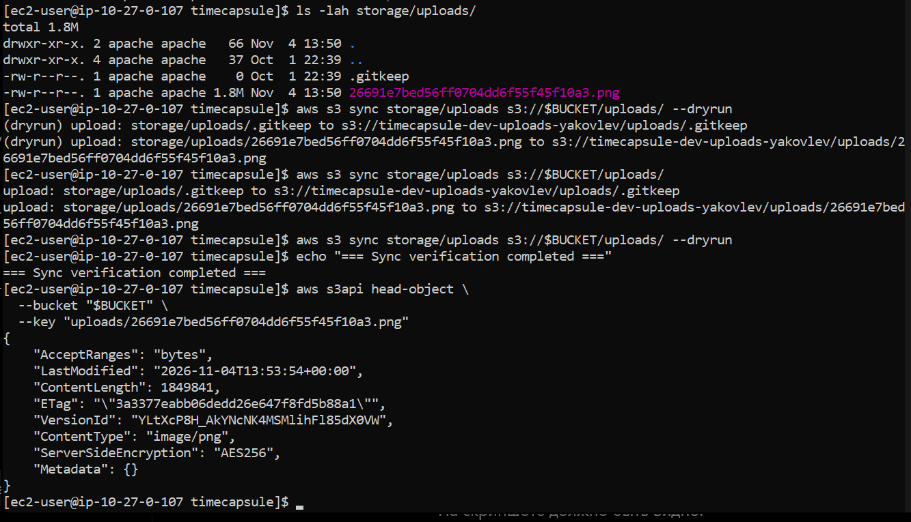

### Task 11. S3 storage module

Updated the PHP OOP implementation to replace local file operations in `src/Storage.php`: `putObject` for uploads, `deleteObject` for deletions, and `createPresignedRequest` for five-minute GET URLs followed by HTTP 302. The application receives the bucket/region from configuration; the SDK uses the EC2 role. The footer identifies S3 instead of local disk. Application-level authorization still precedes file delivery.

**Code changes:** [TimeCapsule implementation commit](https://github.com/my-php-deploying-labs-organization/timecapsule/commit/98144757197c00e1794cb3ef1d18fd5843ccf5b0).

### Task 12. Deployment and download checks

Deployed the Git version on EC2 with PHP-FPM. Verified that the site shows the S3 footer, an existing capsule's image is available, and the `/capsules/3/file` handler replies with `302 Location` pointing to a signed S3 URL. Reopening the same signed URL after its lifetime showed that the link expires. Re-requesting the application endpoint creates a new signed link after access checks.

| S3 footer | Existing capsule | Redirect and signed URL |
|---|---|---|
| 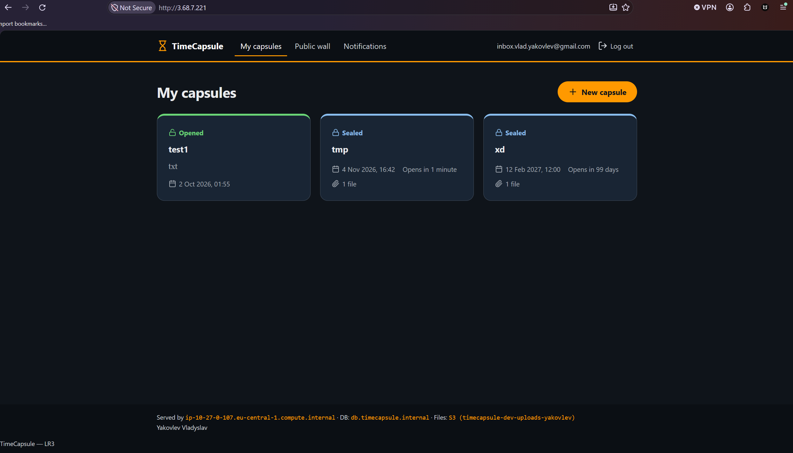 | 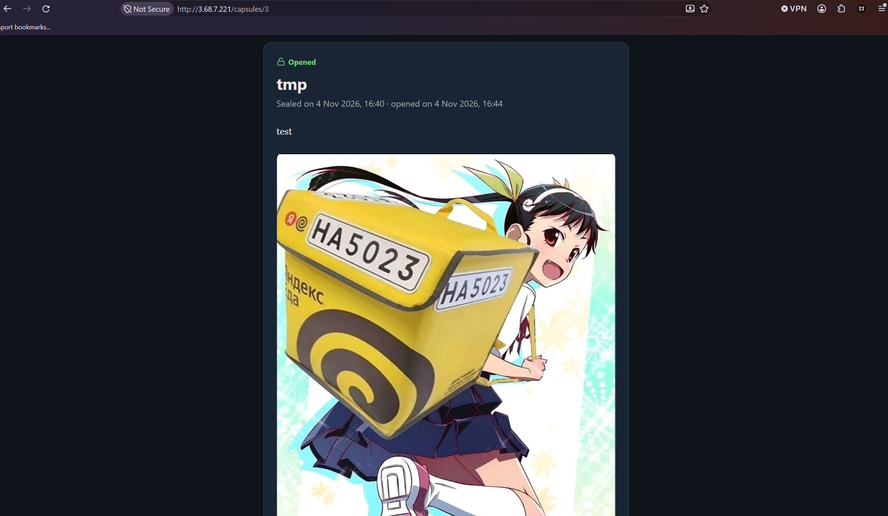 | 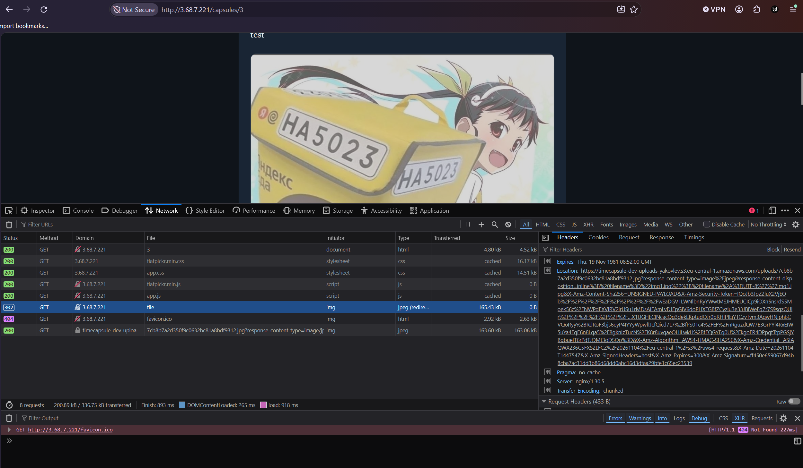 |

**Evidence limitation:** Separate screenshots of a newly created PDF capsule, its original download filename, and a delete marker after deleting a new capsule were not supplied. These particular checks are therefore not claimed as screenshot-verified. A presigned link may be forwarded, but the recipient's access expires with that individual URL; it is not an indefinitely public object URL.

### Task 13. Attachment-independent app-server

Moved the local `storage/uploads/` directory to `/home/ec2-user/uploads-backup`; `storage/` then contained sessions only. Verified storage-independent operation as captured in the stateless test. Replaced the shared IAM managed policy with a version lacking `s3:ListBucket`, leaving only `GetObject`, `PutObject`, `DeleteObject` on `uploads/*`; EC2 listing now returned `AccessDenied`.

A request for a missing object yielded **403** on the restricted EC2 role and **404** in administrative CloudShell. With `ListBucket`, S3 can disclose nonexistence; without it, the response does not reveal whether a key exists. A replacement app-server needs the same software/configuration, IAM role and DB connection, but not the old server's attachment files. PHP session storage is still local and is a separate future scaling concern.

| Local directory removed | List permission denied | Missing-object 403 vs 404 |
|---|---|---|
|  | 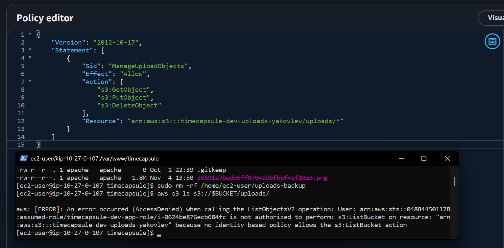 |  |

### Task 14. Updated diagram and decision record

The diagram preserves the Lab 3 VPC, Availability Zones, subnets, app server, bastion, DB and routing, and adds an S3 bucket outside the VPC in `eu-central-1`, the EC2 IAM role, and explicit upload/delete and browser download flows. The architectural choice is documented in [ADR-0003](../adr/0003-attachment-storage.md), comparing EBS, EFS and S3 and describing access, deletion protection, lifecycle costs, and multi-server implications.

## Final architecture and oral-review questions

1. **Attachment GET path.** The browser calls `/capsules/{id}/file`; PHP first checks capsule/user authorization, then signs `GetObject` using the EC2 role. The browser follows the 302 redirect and S3 independently validates the URL signature and role's S3 permissions.
2. **Why a private bucket still works.** Block Public Access, IAM, and the HTTPS-only deny prevent public direct reads. A presigned URL grants narrowly scoped, temporary access to one request; making the entire bucket publicly readable would bypass the application's permission checks.
3. **Protection and cost control.** Versioning preserves noncurrent versions and delete markers, while the application lacks permanent version-deletion permissions. Lifecycle actions control accumulation of old versions and abandoned multipart uploads, subject to retention conditions.
4. **Future scaling.** Multiple EC2 application instances behind a load balancer can reference one S3 bucket without synchronizing attachments. Database connections and local PHP sessions still require separate design for resilient scaling.
5. **Whole-region failure.** Consider S3 cross-region replication and a regional disaster recovery plan for compute, networking, database, DNS and IAM. Replication alone would not make the full application region-resilient.

## Completion

The project uses S3 for attachment storage with private object access, versioning, lifecycle management, an IAM instance role and expiring presigned URLs. The attached screenshots document the observed steps; items without screenshot evidence are identified above rather than asserted as verified.

**Lab cleanup:** stop `bastion`, `app-server` and `db-server` after all checks; retain the S3 bucket and required IAM policies/roles for later labs.
